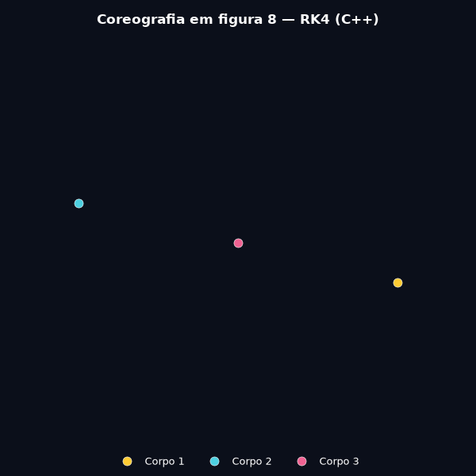
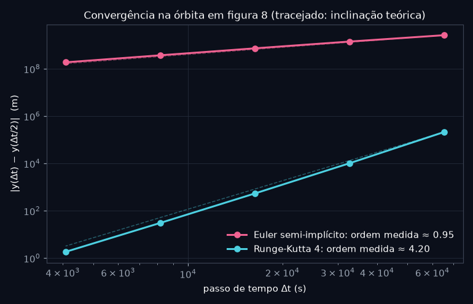
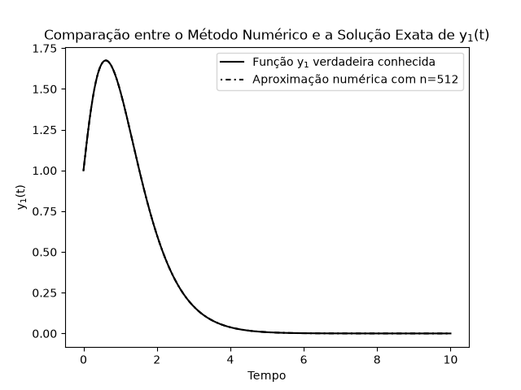
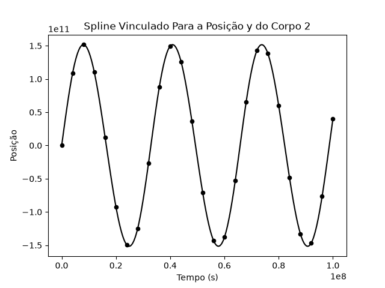

# N-Body Simulator

🌐 **English** | [Português](README.pt-BR.md)

[](LICENSE)

Gravitational **N-body** simulation with numerical methods implemented from scratch in **Python** and **C++**: 4th-order Runge-Kutta, semi-implicit Euler, cubic splines and Crout LU decomposition.

Developed for the course **MAP3122 – Numerical Methods and Applications** at the Polytechnic School of the University of São Paulo (Poli-USP).

<p align="center">
  
  
  
</p>

## About

The project solves Newton's equations of motion for N gravitationally interacting bodies:

$$\ddot{\mathbf r}_i = \sum_{j \ne i} G\, m_j \frac{\mathbf r_j - \mathbf r_i}{\lVert \mathbf r_j - \mathbf r_i \rVert^3}$$

The second-order system is rewritten as a first-order ODE system with 6N variables (3D position and velocity of each body).

**Python (`python/`)**, the main implementation of the coursework:
- **4th-order Runge-Kutta (RK44)** for the three-body problem (18 ODEs);
- **convergence study**, refining the step from n = 4 to n = 2048;
- **clamped cubic splines** interpolating the trajectories. The tridiagonal system is solved with **Crout's method**, and the endpoint derivatives come from the ODE itself;
- **computational verification** against problems with known analytical solutions: a third-order linear ODE and the exponential function.

**C++ (`cpp/`)**, fast simulators for any number of bodies:
- `rk4_nbody`: classic 4th-order Runge-Kutta;
- `euler_nbody`: semi-implicit (symplectic) Euler;
- scripts to animate the output and measure the order of convergence.

### Results

The measured order matches theory: **≈ 1 for Euler** and **≈ 4 for RK4**. On the figure-eight orbit, after two periods RK4 returns to its initial position with a relative error of about 10⁻⁷. Euler, with the same step, is off by about 10⁻³.

<p align="center">
  
</p>

| Verification (RK4 on an ODE with exact solution) | Clamped spline of a trajectory |
|:---:|:---:|
|  |  |

The full report, with the modeling and convergence tables, is available (in Portuguese) at [`relatorio/Problema_3_corpos.pdf`](relatorio/Problema_3_corpos.pdf). Plot labels and folder names are also in Portuguese.

## Requirements

- **Python** 3.10+ with `numpy` and `matplotlib`. `pillow`, used to save the GIFs, is installed along with matplotlib.
- **C++17 compiler**: `g++` or `clang++`.
- `make` (optional, to build with a single command).

Tested with Python 3.14, numpy 2.5, matplotlib 3.11 and g++ on Linux.

## Installation

```bash
git clone https://github.com/jofe2003/n-body-simulator.git
cd n-body-simulator

python -m venv .venv
source .venv/bin/activate          # Windows: .venv\Scripts\activate
pip install -r requirements.txt

cd cpp && make                     # builds rk4_nbody and euler_nbody
```

## Usage

The Python scripts resolve paths relative to their own folder, so they can be run from any directory.

### Python

```bash
python python/RK44.py               # simulates 3 bodies (t = 1e9 s, dt = 1e4 s) -> python/dados/dados.txt  (~5 s)
python python/plotter.py            # 3D animation                               -> assets/tres-corpos-rk44.gif
python python/splineVinculado.py    # splines for the 18 variables               -> python/imagens/splines/
python python/RK44Ordem.py          # convergence study                          -> python/imagens/convergencia/ and dados/tables.txt

# Verification against known solutions
python python/verificacao/RK44SM.py
python python/verificacao/splineNatural.py
python python/verificacao/splineVinculadoExp.py
```

`plotter.py` and `splineVinculado.py` read the `dados.txt` file produced by `RK44.py`. That file is not versioned, so run `RK44.py` first.

### C++

```bash
cd cpp
./rk4_nbody   entradas/figura8.txt out.txt        # default: data.txt -> output.txt
./euler_nbody entradas/figura8.txt out.txt

# Animation (the number of bodies is inferred from the output)
python scripts/animar.py out.txt figure8.gif --2d --nomes "A,B,C" --rastro 0.25

# Order of convergence (runs with dt, dt/2, dt/4, ...)
python scripts/ordem_convergencia.py ./rk4_nbody entradas/figura8.txt 6 8
python scripts/comparar_metodos.py              # Euler vs RK4 plot -> assets/ordem-convergencia.png
```

**Input format.** SI units; lines starting with `#` are comments.

```
n_bodies  dt  n_steps  save_every
x y z  vx vy vz  mass         # one line per body
```

Ready-made examples in `cpp/entradas/`:

| File | Scenario |
|---|---|
| `figura8.txt` | Figure-eight choreography of three equal masses (Chenciner & Montgomery, 2000) |
| `sistema_solar_interno.txt` | Sun, Mercury, Venus, Earth and Mars over 2 years |
| `sol_terra_lua.txt` | Sun, Earth and Moon over 1 year |

**Output.** One line per saved time step, with `x y z` of each body in sequence.

## Project structure

```
n-body-simulator/
├── README.md                     # English version
├── README.pt-BR.md               # Portuguese version
├── LICENSE
├── requirements.txt
├── assets/                       # GIFs and images used in the README
├── python/
│   ├── RK44.py                   # Three-body simulation with Runge-Kutta 4
│   ├── RK44Ordem.py              # Convergence/order study of RK44
│   ├── splineVinculado.py        # Clamped cubic splines of the trajectories
│   ├── crout.py                  # Tridiagonal system solver (Crout)
│   ├── plotter.py                # 3D animation of the simulation
│   ├── dados/                    # Outputs: trajectory, derivatives, LaTeX tables
│   ├── imagens/                  # Convergence and spline plots
│   └── verificacao/              # Tests against known analytical solutions
├── cpp/
│   ├── rk4_nbody.cpp             # Runge-Kutta 4 for N bodies
│   ├── euler_nbody.cpp           # Semi-implicit Euler for N bodies
│   ├── Makefile
│   ├── entradas/                 # Example initial conditions
│   └── scripts/                  # Animation, order of convergence, comparison
└── relatorio/                    # Report (LaTeX and PDF)
```

## Authors

- Felipe Luís Korbes
- João Felipe de Souza Melo

## License

Distributed under the MIT License. See [`LICENSE`](LICENSE).
