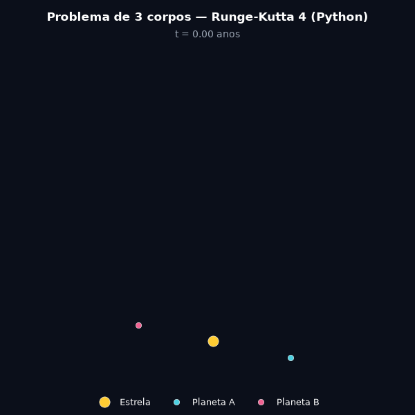
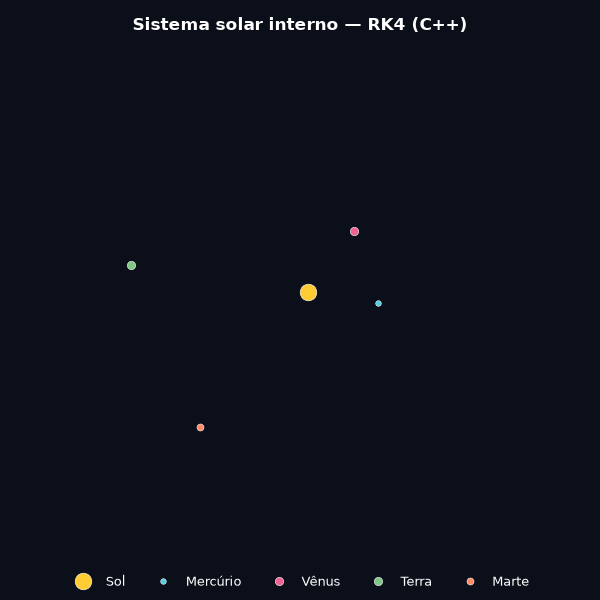

# N-Body Simulator

Simulação gravitacional de **N corpos** com métodos numéricos implementados do zero, em **Python** e **C++**: Runge-Kutta de 4ª ordem, Euler semi-implícito, splines cúbicas e decomposição LU de Crout.

Projeto da disciplina **MAP3122 – Métodos Numéricos e Aplicações** (Escola Politécnica da USP).

<p align="center">
  
  
  
</p>

## Sobre

O projeto resolve as equações de movimento de Newton para N corpos que interagem gravitacionalmente:

$$\ddot{\mathbf r}_i = \sum_{j \ne i} G\, m_j \frac{\mathbf r_j - \mathbf r_i}{\lVert \mathbf r_j - \mathbf r_i \rVert^3}$$

O sistema de 2ª ordem é reescrito como um sistema de EDOs de 1ª ordem, com 6N variáveis (posição e velocidade em 3D de cada corpo).

**Python (`python/`)** — implementação principal do trabalho:
- **Runge-Kutta 4 (RK44)** para o problema de 3 corpos (18 EDOs);
- **estudo de convergência**, refinando o passo de n = 4 até n = 2048;
- **splines cúbicas vinculadas (clamped)** interpolando as trajetórias. O sistema tridiagonal é resolvido pelo **método de Crout** e as derivadas nas extremidades vêm da própria EDO;
- **verificação computacional** com problemas de solução analítica conhecida: uma EDO linear de 3ª ordem e a função exponencial.

**C++ (`cpp/`)** — simuladores rápidos para qualquer número de corpos:
- `rk4_nbody`: Runge-Kutta 4 clássico;
- `euler_nbody`: Euler semi-implícito (simplético);
- scripts para animar a saída e medir a ordem de convergência.

### Resultados

A ordem medida coincide com a teórica: **≈ 1 para Euler** e **≈ 4 para RK4**. Na órbita em figura 8, depois de dois períodos, o RK4 volta à posição inicial com erro relativo da ordem de 10⁻⁷. O Euler, com o mesmo passo, erra na ordem de 10⁻³.

<p align="center">
  
</p>

| Verificação (RK4 em EDO com solução exata) | Spline vinculada das trajetórias |
|:---:|:---:|
|  |  |

O relatório completo, com a modelagem e as tabelas de convergência, está em [`relatorio/Problema_3_corpos.pdf`](relatorio/Problema_3_corpos.pdf).

## Requisitos

- **Python** 3.10+ com `numpy` e `matplotlib`. O `pillow`, que salva os GIFs, é instalado junto com o matplotlib.
- **Compilador C++17**: `g++` ou `clang++`.
- `make` (opcional, para compilar com um comando).

Testado com Python 3.14, numpy 2.5, matplotlib 3.11 e g++ no Linux.

## Instalação

```bash
git clone https://github.com/jofe2003/n-body-simulator.git
cd n-body-simulator

python -m venv .venv
source .venv/bin/activate          # Windows: .venv\Scripts\activate
pip install -r requirements.txt

cd cpp && make                     # compila rk4_nbody e euler_nbody
```

## Uso

Os scripts Python usam caminhos relativos à própria pasta, então podem ser executados de qualquer diretório.

### Python

```bash
python python/RK44.py               # simula 3 corpos (t = 1e9 s, dt = 1e4 s) -> python/dados/dados.txt  (~5 s)
python python/plotter.py            # animação 3D                             -> assets/tres-corpos-rk44.gif
python python/splineVinculado.py    # splines das 18 variáveis                -> python/imagens/splines/
python python/RK44Ordem.py          # estudo de convergência                  -> python/imagens/convergencia/ e dados/tables.txt

# Verificação com soluções conhecidas
python python/verificacao/RK44SM.py
python python/verificacao/splineNatural.py
python python/verificacao/splineVinculadoExp.py
```

`plotter.py` e `splineVinculado.py` leem o `dados.txt` gerado pelo `RK44.py` (ele não é versionado, então rode o `RK44.py` primeiro).

### C++

```bash
cd cpp
./rk4_nbody   entradas/figura8.txt saida.txt      # padrão: data.txt -> output.txt
./euler_nbody entradas/figura8.txt saida.txt

# Animação (número de corpos deduzido da saída)
python scripts/animar.py saida.txt figura8.gif --2d --nomes "A,B,C" --rastro 0.25

# Ordem de convergência (roda com dt, dt/2, dt/4, ...)
python scripts/ordem_convergencia.py ./rk4_nbody entradas/figura8.txt 6 8
python scripts/comparar_metodos.py              # gráfico Euler x RK4 -> assets/ordem-convergencia.png
```

**Formato da entrada.** Unidades SI; linhas com `#` são comentários.

```
n_corpos  dt  n_passos  salvar_a_cada
x y z  vx vy vz  massa        # uma linha por corpo
```

Exemplos prontos em `cpp/entradas/`:

| Arquivo | Cenário |
|---|---|
| `figura8.txt` | Coreografia em figura 8 de três massas iguais (Chenciner & Montgomery, 2000) |
| `sistema_solar_interno.txt` | Sol, Mercúrio, Vênus, Terra e Marte por 2 anos |
| `sol_terra_lua.txt` | Sol, Terra e Lua por 1 ano |

**Saída.** Uma linha por instante salvo, com `x y z` de cada corpo em sequência.

## Estrutura de pastas

```
n-body-simulator/
├── README.md
├── requirements.txt
├── assets/                       # GIFs e imagens usados no README
├── python/
│   ├── RK44.py                   # Simulação dos 3 corpos com Runge-Kutta 4
│   ├── RK44Ordem.py              # Estudo de convergência/ordem do RK44
│   ├── splineVinculado.py        # Splines cúbicas vinculadas das trajetórias
│   ├── crout.py                  # Solução de sistemas tridiagonais (Crout)
│   ├── plotter.py                # Animação 3D da simulação
│   ├── dados/                    # Saídas: trajetória, derivadas, tabelas LaTeX
│   ├── imagens/                  # Gráficos de convergência e de splines
│   └── verificacao/              # Testes com soluções analíticas conhecidas
├── cpp/
│   ├── rk4_nbody.cpp             # Runge-Kutta 4 para N corpos
│   ├── euler_nbody.cpp           # Euler semi-implícito para N corpos
│   ├── Makefile
│   ├── entradas/                 # Condições iniciais de exemplo
│   └── scripts/                  # Animação, ordem de convergência, comparação
└── relatorio/                    # Relatório em LaTeX e PDF
```

## Autores

- Felipe Luís Korbes
- João Felipe de Souza Melo

Professor: Alexandre Megiorin Roma
